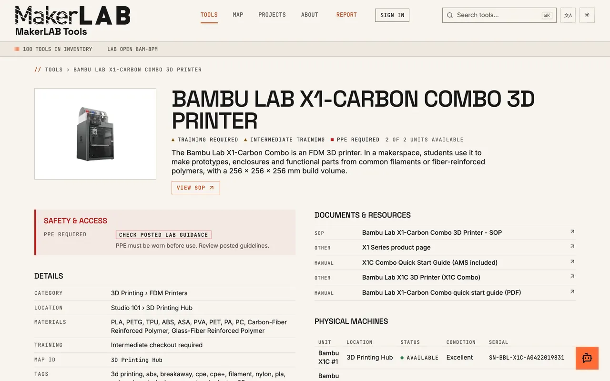
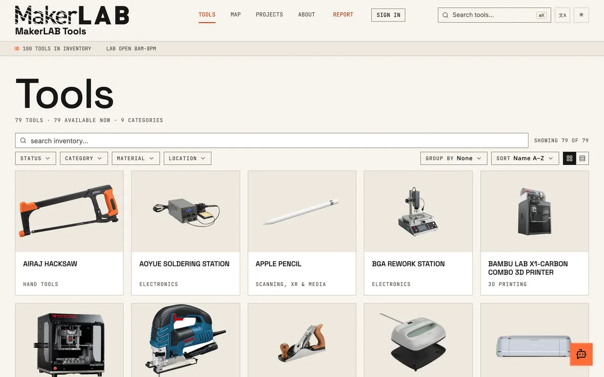
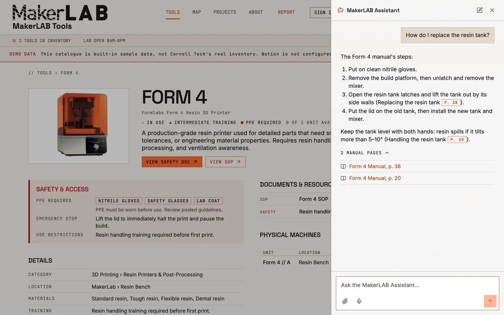
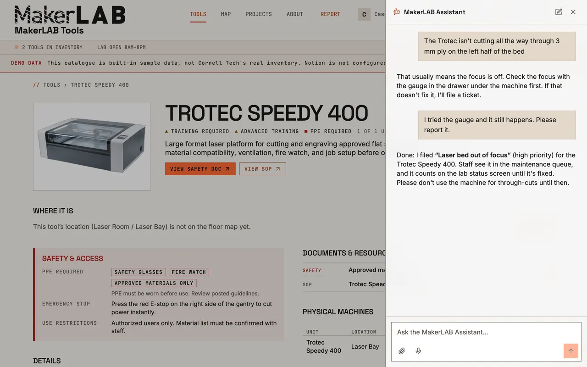
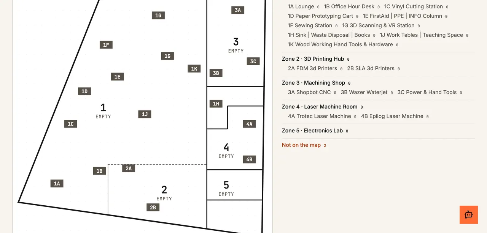
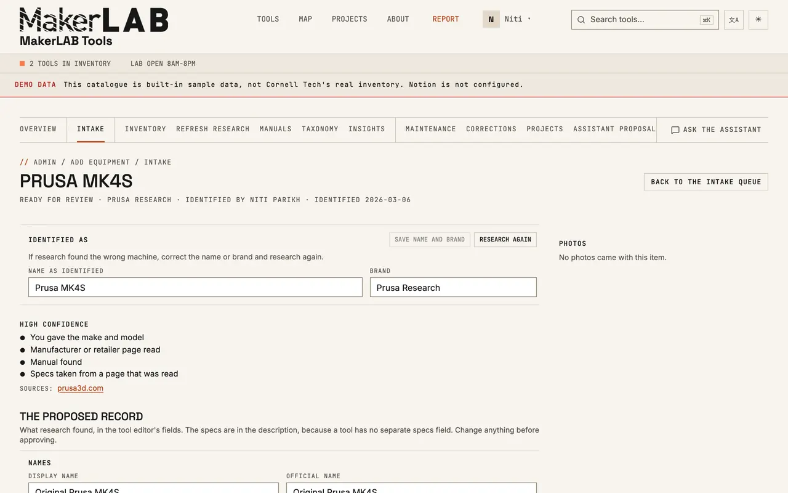
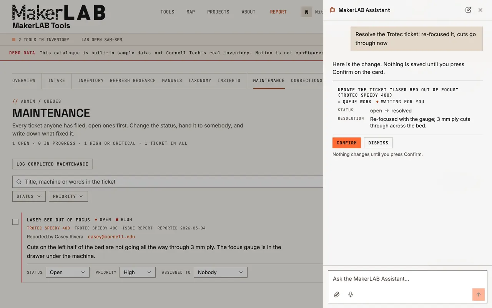
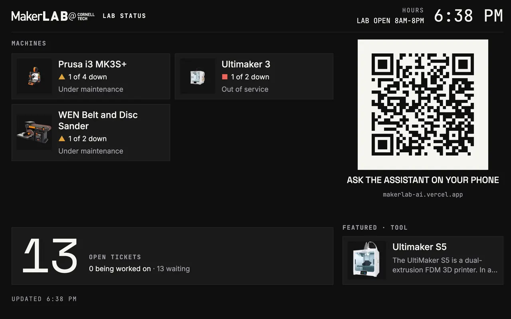
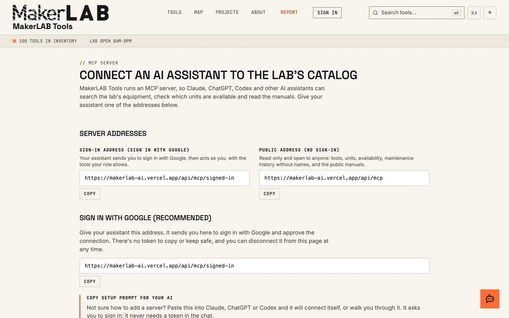
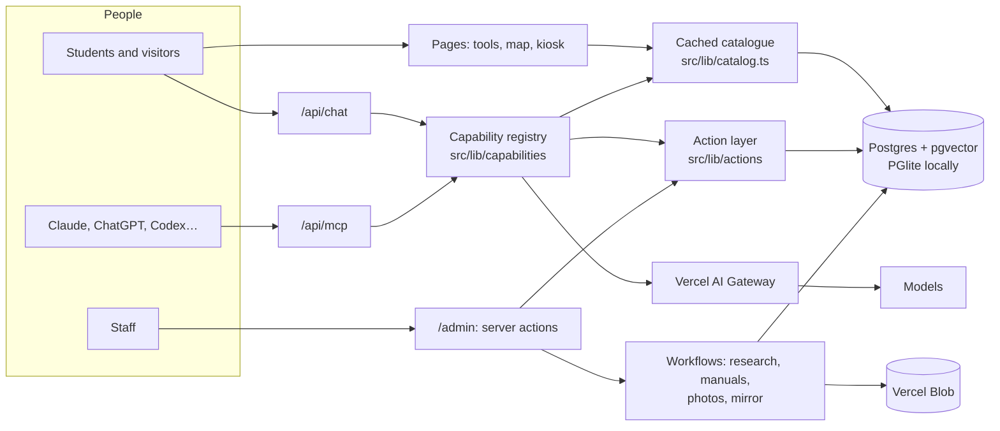

# MakerLAB Tools

**An equipment catalogue and AI assistant for a makerspace.** Students find a machine,
read how to use it, and ask an assistant that answers from the lab's own inventory and
manuals, citing the page. Staff keep the inventory, work maintenance tickets and add new
equipment in the same app. Everything is also served over MCP, so people can use the lab
from Claude, ChatGPT or any other AI client.

**Live at the Cornell Tech MakerLAB:** <https://www.makerlabai.app> ·
**Run it for your own lab:** [`docs/fork.md`](docs/fork.md)



---

## Where it comes from

MakerLAB Tools was built for, and runs at, the
[Cornell Tech MakerLAB](https://tech.cornell.edu/), the fabrication lab on Cornell's
New York City campus. It catalogues the lab's ~100 machines (laser cutters, 3D printers,
CNC routers, electronics benches and hand tools), searches about 50 of their manuals,
and is what students reach when they scan the QR label on a machine.

The software is not tied to Cornell. Everything specific to the lab (names, logos,
photos, the floor plan, the sign-in domain) lives in data and environment variables, so
another makerspace can fork it and run its own copy. With no configuration at all it
starts on demo data.

**Paper.** The system was presented as a demo at the International Symposium on
Academic Makerspaces (ISAM 2026), Houston: *MakerLAB AI: Tools to Operate, Fix, and
Build in Makerspaces* (Steinberg, Parikh and Ramirez Peraza). The abstract, figures and
PDF are in [`docs/isam-2026-demo/`](docs/isam-2026-demo/abstract-v2.md).

---

## Screens

| | |
|---|---|
|  |  |
| **Catalogue.** Fuzzy search and facets (status, category, material, location) across every machine. | **The assistant.** Opened on a tool page, it answers from that machine's manuals and cites the pages. |
|  |  |
| **Reporting a problem.** It troubleshoots first, then files a ticket against the right machine. | **Floor map.** Where each machine is, zone by zone. |
|  |  |
| **Intake.** Staff add equipment from a name, a link or a photo; research agents draft the record for approval. | **Maintenance.** Staff work the ticket queue; changes the assistant proposes wait for Confirm. |
|  |  |
| **Kiosk.** A lab status board for the TV at the door, with a QR code to the assistant. | **MCP.** Connect Claude, ChatGPT or Codex to the lab's catalogue. |

More, with a walkthrough video, on the product page: <https://www.makerlabai.app/product>.

## What it does

- **Tool pages.** Specs, location, required training and PPE, manuals and SOPs, and a
  live table of individual units with status and condition. Printed QR labels open the
  right page.
- **An assistant on every page.** Opened from a tool page it becomes a specialist on
  that machine: it searches the machine's manuals and cites the page, reads photos of
  error screens, replies in the language it is asked in, troubleshoots first and files a
  maintenance ticket when something is genuinely broken.
- **Research and intake.** Staff add equipment by pasting a list or a product link, or
  by photographing a label. Background agents identify each item and research its name,
  description, manuals and a product photo, then leave a draft for a person to approve.
- **Admin.** `/admin` holds the inventory editor, maintenance, corrections and proposal
  queues, project moderation, user roles and an optional one-way mirror into Notion.
  Anything the assistant or a student creates starts unpublished.
- **MCP server.** The catalogue is a Model Context Protocol server at `/api/mcp`:
  read-only without an account, or acting as yourself after signing in.
  See [`docs/mcp.md`](docs/mcp.md).
- **Twelve languages, white-label.** Interface strings go through `next-intl`; branding,
  colours, institution and assistant name come from environment variables.

---

## Quick start

```bash
git clone https://github.com/philosophercode/makerlab-tools.git
cd makerlab-tools
npm install                  # Node 24 (.nvmrc)
npm run dev                  # http://localhost:3000
```

**It runs with no configuration.** With `DATABASE_URL` unset the app uses an in-process
Postgres (PGlite) seeded with demo tools, shows a **demo data** banner, and stores
uploads in `.blob-data/`. Add `AI_GATEWAY_API_KEY` to `.env.local` to turn the assistant
on. [`.env.example`](.env.example) documents every variable, and
[`docs/fork.md`](docs/fork.md) walks through rebranding and hosting your own copy.

| Feature | Needs |
|---|---|
| Tool pages, search, facets, QR labels, twelve languages, kiosk | Nothing; works on the demo data |
| The assistant, answering from your manuals with page citations | `AI_GATEWAY_API_KEY` |
| Adding equipment from a list, a link or a photo | The assistant's key |
| Maintenance tickets and staff email | Sign-in; email needs Resend |
| MCP for Claude, ChatGPT and Codex ([`docs/mcp.md`](docs/mcp.md)) | Nothing for public reads; sign-in to act |
| A floor map of your lab ([`docs/map.md`](docs/map.md)) | A plan image, traced with the prompt in the guide |

### Commands

```bash
npm run dev            # dev server
npm run build          # db:migrate, then next build
npm run lint           # eslint
npm run typecheck      # tsc --noEmit
npm test               # vitest: unit + integration + component
npm run test:e2e       # playwright (once: npx playwright install chromium)
npm run test:all       # all of the above; must pass before a merge
npm run eval:all       # agent evals; real, paid model calls, never in CI
```

The test suite needs **no credentials and makes no network calls**.
Working against a persistent local database is covered in [`docs/deploy.md`](docs/deploy.md).

---

## How it's built

Next.js 16 (App Router, React Server Components), React 19, TypeScript, Tailwind CSS 4
with shadcn/ui. **Postgres** (Neon) through Drizzle ORM, with pgvector for manual
search; **Vercel Blob** for files. Better Auth with Google sign-in. Models through the
**Vercel AI Gateway** via the AI SDK; background jobs on the Workflow SDK. Vitest,
React Testing Library, MSW and Playwright. Hosted on Vercel.



1. **Postgres is the source of truth and the app is its admin UI.** Notion is read only
   by the one-time import and can optionally receive a one-way copy.
2. **The assistant reads live data through tool calls**, so publishing a machine reaches
   the chat at once, with no prompt rebuild or deploy.
3. **Every agent ability is declared once** in the capability registry; the chat and the
   MCP server are thin adapters over it, behind the same permission check.
4. **Slow AI work runs as durable workflows** (researching a machine, finding its photo,
   indexing its manuals), so a page never waits on a model.

Manuals are stored as text, split into passages, embedded and reranked, so an answer
names the page it came from. Everything a model writes about the catalogue is a draft or
a proposal a person approves. [`docs/architecture-guide.md`](docs/architecture-guide.md)
explains each decision.

---

## Documentation

| Document | For |
|---|---|
| [`docs/fork.md`](docs/fork.md) | **Forking it for your lab.** What to rebrand and replace, then where to host it. |
| [`docs/deploy.md`](docs/deploy.md) | Local setup stages, then a Vercel deployment step by step. |
| [`docs/handover.md`](docs/handover.md) | Running it: accounts, routine tasks, backups, what to do when it breaks. |
| [`docs/architecture-guide.md`](docs/architecture-guide.md) | **How it works.** Start here if you are inheriting the code. |
| [`docs/assistant.md`](docs/assistant.md) | What the assistant can do, by role. |
| [`docs/mcp.md`](docs/mcp.md) | Connecting Claude, ChatGPT, Codex and other MCP clients. |
| [`docs/map.md`](docs/map.md) | Your lab's floor map, traced from a plan image. |
| [`docs/operations.md`](docs/operations.md) | Monitoring, backups and restore. |
| [`docs/testing.md`](docs/testing.md) | Test suite runbook. |
| [`docs/constitution.md`](docs/constitution.md), [`docs/specs/`](docs/specs/README.md) | The rules every change respects, and the design specs. |
| [`AGENTS.md`](AGENTS.md), [`docs/architecture/`](docs/architecture/) | Conventions and the app area by area, for people and AI assistants alike. |

## Contributing

[`.github/CONTRIBUTING.md`](.github/CONTRIBUTING.md) has the setup and the checklist.
Every feature starts with a spec that merges **before** the implementation
([`docs/constitution.md`](docs/constitution.md), Article 1), and `npm run test:all` must
pass before any merge. Outside contributors sign the
[Contributor License Agreement](docs/legal/CLA.md) once. Report security problems
privately, as [`.github/SECURITY.md`](.github/SECURITY.md) describes.

## Credits

Built by Isaac Steinberg for the Cornell Tech MakerLAB, which Niti Parikh (Director)
and Luis Rodrigo Navarro (Assistant Director) run. Thanks to Miguel Ramirez Peraza, who
built the first inventory search that started it. An older Airtable-backed version is
preserved at the git tag
[`v4-final`](https://github.com/philosophercode/makerlab-tools/tree/v4-final).

## License

[GNU Affero General Public License v3.0](LICENSE) (`AGPL-3.0-only`). You may use, change
and host it for any purpose; if you let others use a changed version over a network, you
must offer them its source. Names, logos and photos are not covered.
[`docs/legal/LICENSING.md`](docs/legal/LICENSING.md) explains it in plain language.

Copyright (C) 2026 Isaac Steinberg.
